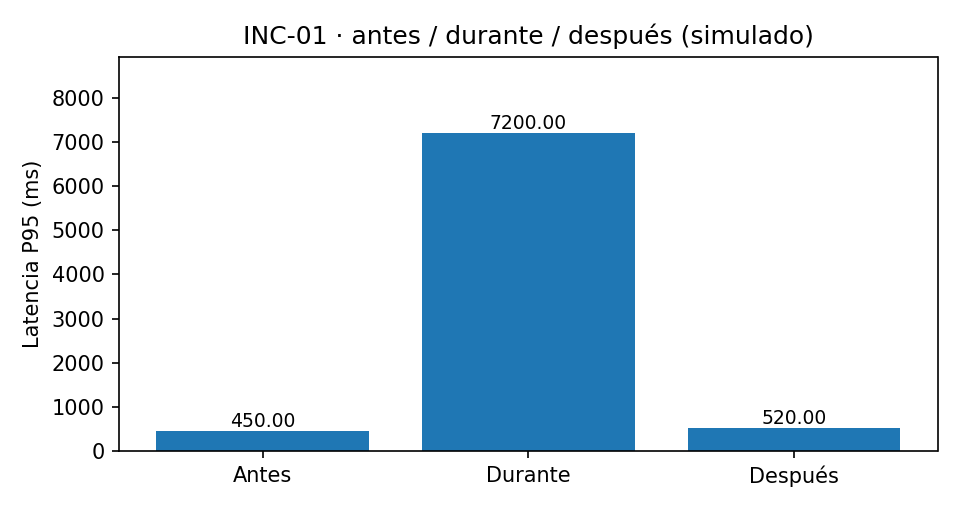
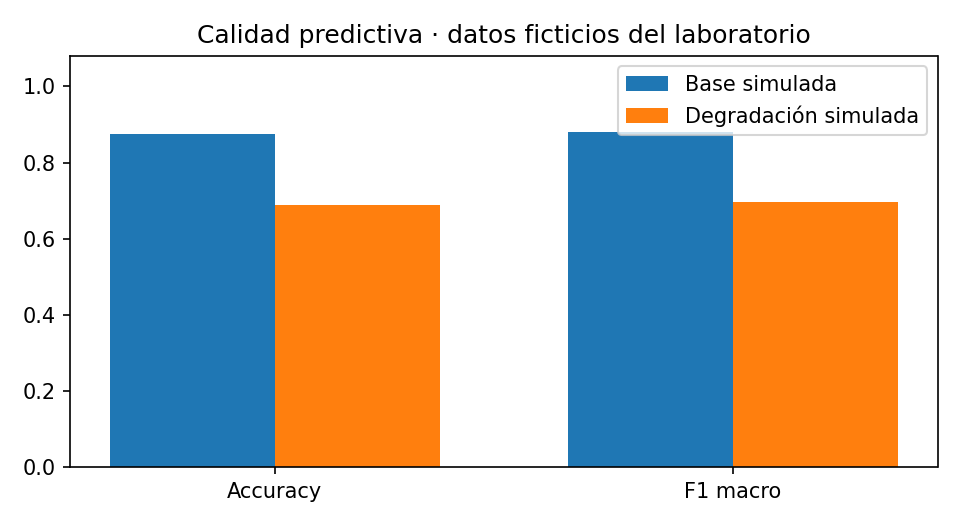

# CHATBOT CIMA — Actividad 8 | Observabilidad y respuesta a incidentes

**Estado:** segunda iteración del laboratorio académico; pruebas reproducibles en GitHub Actions. **Los datos de esta carpeta son simulaciones salvo que se indique expresamente una medición HTTP real.**

## Objetivo

Medir el servicio sintético CIMA ya desplegado, registrar métricas y registros estructurados, calcular SLO, gestionar alertas con control de ruido, detectar cambio de distribución de consultas y simular incidentes con runbooks. **No modifica FaseII, el modelo, Render ni datos institucionales.**

## Resultados visibles de laboratorio (iteración 2)

> **Nota de integridad:** los valores de esta tabla proceden de escenarios sintéticos y predicciones **ficticias**, no de inferencias del modelo desplegado. El workflow de GitHub Actions solo ejecuta simulaciones offline; su estado verde acredita la ejecución del código, no la calidad en producción.

| Escenario | Estado inicial | Durante el incidente | Recuperación simulada | Runbook |
|---|---:|---:|---:|---|
| INC-01 · Latencia P95 | 450 ms | **7,200 ms** (umbral 3,000) | 520 ms | RB-02 |
| INC-02 · PSI de clases | 0.000 | **2.869** (umbral crítico 0.250) | 0.000 | RB-03 |
| INC-03 · Errores HTTP 5xx | 0 % | **20 %** (umbral 1 %) | 0 % | RB-01 |

**Control antirruido:** primera alerta = **1 emitida**; repetición a los 2 minutos = **0 emitidas, 1 suprimida**; repetición después de 31 minutos = **1 emitida**. Ventana de supresión: 30 minutos.

**Calidad con 32 pares de etiquetas/predicciones ficticias:**

| Indicador | Línea base simulada | Degradación simulada | Umbral de alerta |
|---|---:|---:|---:|
| Accuracy | 87.50 % | **68.75 %** | 80 % |
| F1 macro | 88.09 % | **69.68 %** | 80 % |





**Consulta directa de evidencia:** [salida de consola con alertas](results/incidentes/consola_alertas_demo.txt) · [bitácora de runbooks y antirruido](results/incidentes/runbooks_ejecutados_demo.json) · [indicadores de calidad simulada](results/metricas/calidad_demo.json) · [dashboard HTML estático](results/dashboards/dashboard_simulado.html).

En la entrega final añadiremos capturas de la ejecución alojada en GitHub, junto con cualquier medición HTTP real obtenida de forma separada. No se afirma que se haya reentrenado o publicado automáticamente un modelo.

## Arquitectura

`Render (CIMA Fase II) → monitor HTTP bajo demanda (Python) → JSON/JSONL → alertas → dashboard HTML estático`.

El monitor produce registros de eventos con `trace_id` local (correlación de sondeo); no implementa trazado distribuido completo. Para el criterio de trazas de la rúbrica será necesario incorporar trazas reales e identificadores interoperables en una iteración posterior.

## Estructura

- `config/alerts.yaml`: parámetros SLO, umbrales y cooldown.
- `src/monitor.py`: sondeo GET /health y opcional POST /predict con solo cuatro consultas sintéticas.
- `src/alertas.py`, `src/pipeline.py`: reglas de alertas, presupuesto de muestras y deduplicación.
- `src/drift.py`: PSI de cambio en mezcla de categorías, no mide precisión.
- `src/incidentes.py`: tres incidentes **offline simulados** y comprobación de recuperación.
- `src/laboratorio.py`: alertas legibles, control antirruido y acciones sobre estado JSON aislado (no sobre Render).
- `src/calidad.py`: accuracy, precision, recall y F1 **solo cuando existen etiquetas**; demo ficticia y opción `--csv` para evaluar lotes etiquetados.
- `src/visualizar_laboratorio.py`: gráficos PNG de los incidentes y calidad simulada.
- `src/dashboard.py`: visualización **estática** de último lote; no se presenta como dashboard en tiempo real.
- `docs/Runbooks.md`, `docs/plan_evidencias.md`: respuesta estructurada y matriz de evidencia.
- `tests/`: pruebas `unittest` sin llamadas externas.

## Ejecución 100 % en la nube (Google Colab)

```python
!git clone https://github.com/alfredosalazar-ai/deep-learning-experiments.git
%cd /content/deep-learning-experiments/Actividad8
!pip install -r requirements.txt
!python -m unittest discover -s tests -v
!python -m src.incidentes
!python -m src.pipeline --simulado
!python -m src.laboratorio
!python -m src.calidad
!python -m src.visualizar_laboratorio
```

Para generar **mediciones HTTP reales** en una segunda ejecución (bajo demanda):

```python
!python -m src.monitor --solo-health
!python -m src.pipeline
```

Para la inferencia sintética opcional (cuatro solicitudes como máximo):

```python
!python -m src.monitor --incluye-predict --consultas 4 --health-checks 5
!python -m src.pipeline
```

No añadir un cron que mantenga despierto Render Free. El primer sondeo puede activar el servicio; considerar arranque en frío. El script no introduce latencia ni genera errores deliberados en la API pública.

Los HTML y JSON quedan en `results/`. En Colab descargar o publicar únicamente outputs sintéticos revisados. **No subir archivos con credenciales ni datos operativos reales.**

## Umbrales experimentales

- SLO disponibilidad: `>= 99 %` en la ventana definida.
- SLO fallas HTTP 5xx: `<= 1 %`.
- P95 del POST `/predict`: `<= 3000 ms` con instancia caliente y al menos 5 muestras.
- Falsas elegibilidades: 0 observadas (requiere etiquetas independientes para interpretar).
- PSI de clases: advertencia `>= 0.10`, crítico `>= 0.25`; al menos 30 muestras.
- Antirruido: al menos 10 health checks para alertas de disponibilidad, 30 muestras para drift y cooldown de 30 minutos por código de alerta.

**Limitaciones:** con 3 a 5 comprobaciones no se pueden estimar SLO de disponibilidad. El error budget real exige una ventana de medición explícita y volumen suficiente; el script registra fracciones, pero no afirma cumplimiento mensual. El PSI de clases predichas puede confundir cambio de tráfico con deriva predictiva. La simulación es independiente del servicio vivo. No incluye notificación externa o rollback automático.

## GitHub Actions

Publicar el workflow del paquete en la **raíz del repositorio** como:

`.github/workflows/actividad8-observabilidad.yml`

El pipeline solo ejecuta tests y simulación offline. No consume recursos de Render ni ejecuta pruebas contra una API remota. Exporta un artefacto con JSON, consola de alertas, dashboard y PNG. Para medir calidad real se requiere un CSV **independiente** con columnas `clase_real,clase_predicha`, generado previamente sobre datos etiquetados; `python -m src.calidad --csv archivo.csv` calcula la evaluación por clase, pero no verifica por sí solo la independencia del lote.

## Fuentes y continuidad

- Proyecto: https://github.com/alfredosalazar-ai/deep-learning-experiments
- API académica: https://chatbot-cima-fase2.onrender.com/
- Guía de métricas SLI/SLO: https://sre.google/sre-book/service-level-objectives/
- GitHub Actions: https://docs.github.com/en/actions
- Python urllib: https://docs.python.org/3/library/urllib.request.html
- Detector PSI: indicador de cambio poblacional; su interpretación exige contexto y etiquetado independiente.
