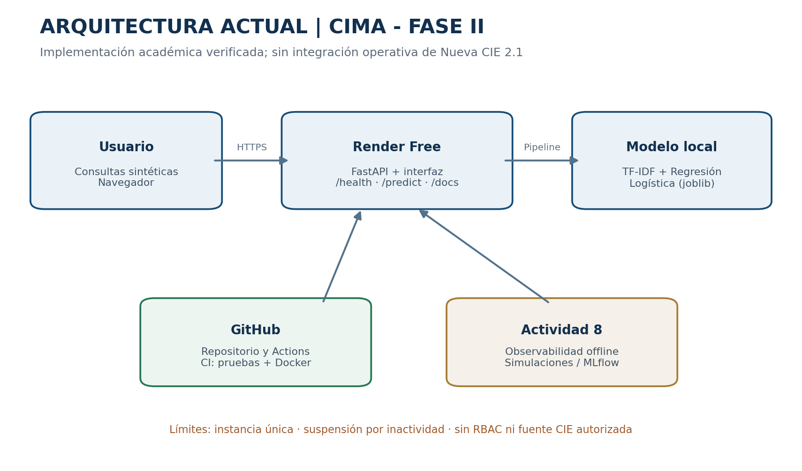
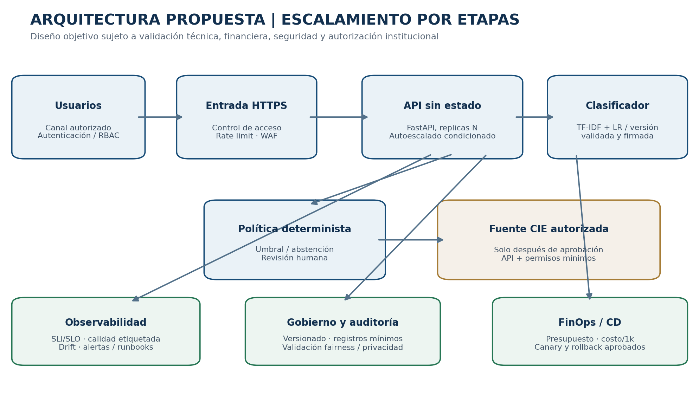

# CHATBOT CIMA — Actividad 9 | Escalabilidad, FinOps y gobernanza responsable

**Estatus:** propuesta académica de rediseño; no despliegue productivo.

## Resumen de la entrega

| Descripción | Resultado | Evidencia |
|---|---|---|
| Arquitectura y escalabilidad | Comparación vertical/horizontal, cuellos de botella, propuesta por etapas | [Reporte PDF](Actividad 9 Escalabilidad Y Gobernanza CIMA Alfredo Salazar.pdf), diagramas PNG |
| FinOps y costos | Precios de referencia, 6 configuraciones, 3 volúmenes hipotéticos, fórmulas de costo/capacidad | [Anexo Excel](Anexo_Tecnico_FinOps_CIMA_Actividad9.xlsx) |
| Ética, riesgo y cumplimiento | Riesgos de clasificación, trazabilidad, LFPDPPP, ISO 42001 y NIST AI RMF | Reporte, hojas `Fairness y sesgos` y `Riesgos y controles` |
| Escalamiento responsable | Puertas de control, responsables, SLO propuestos, límites de uso | Reporte, sección 8 |

## Diagramas

## Lectura del anexo

Los precios son **referencias públicas de Render en USD/mes** y las hipótesis de tráfico, tiempo de CPU y utilización **no son medidas reales**. El Excel permite modificar las celdas azules en `Supuestos` para recalcular escenarios. No incluye cotización comercial, soporte, personal, medidas de seguridad ni costos integrales de una implementación bancaria.

No se afirma una auditoría empírica de *fairness* por grupos protegidos: los datos actuales son sintéticos y no están diseñados para esa evaluación. La hoja específica documenta el diseño de prueba por subtipos operativos y deja los resultados sin medir donde no hay evidencia.

## Continuidad de CIMA

- [Fase II — despliegue académico](../FaseII/)
- [Actividad 6 — evaluación](../Actividad6/)
- [Actividad 8 — observabilidad offline](../Actividad8/)
- [Repositorio principal](https://github.com/alfredosalazar-ai/deep-learning-experiments)

**Alcance de seguridad:** no usar datos personales ni bancarios, no conectar Nueva CIE 2.1 ni habilitar aprobaciones o pagos automáticos en la aplicación académica.
