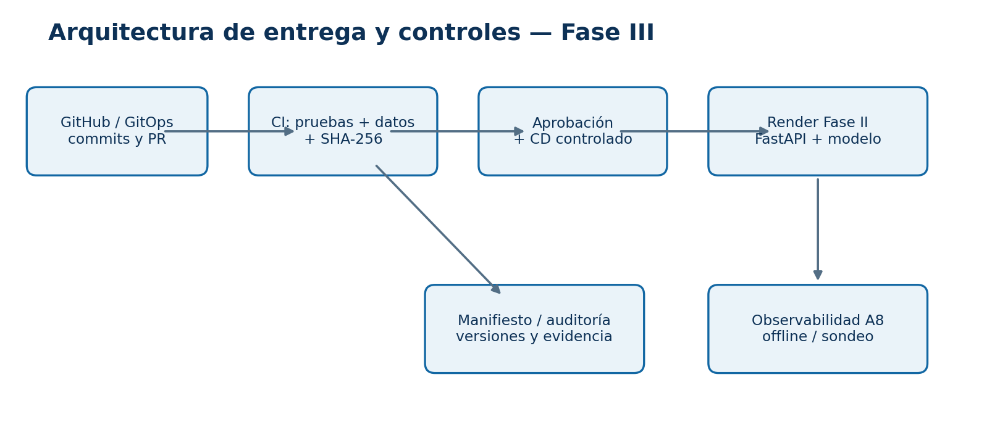

# CHATBOT CIMA — Proyecto Fase III | MLOps, GitOps y cierre profesional

**Autor:** Alfredo Salazar · **Curso:** Gestión de proyectos de inteligencia artificial · **Fecha:** noviembre 2026.

> **Alcance:** solución académica con textos sintéticos. La demostración se apoya en la API de Fase II, CI de GitHub Actions, observabilidad simulada de Actividad 8 y rediseño de gobernanza de Actividad 9. **No es un sistema bancario listo para producción.** No maneja información de clientes ni autoriza pagos.

## Resumen ejecutivo

CIMA clasifica consultas relativas a movimientos de pago de adjudicados en `INDIVIDUAL`, `PAQUETE`, `AMBIGUA` y `FUERA_ALCANCE`. Solo una solicitud individual que cumpla la política puede ser candidata a atención automática; los demás casos requieren revisión humana. Fase III documenta la cadena código → pruebas → inventario → manifiesto SHA-256 → aprobación → despliegue controlado.

## Resultados visibles y origen

| Resultado | Magnitud | Tipo de evidencia |
|---|---:|---|
| Pruebas Fase III en entorno de construcción | **9/9** | Ejecución local; GitHub CI por verificar |
| Dataset de contrato Fase III | **16** consultas sintéticas (4 por clase) | Validación estructural, **no** accuracy |
| Actividad 6 — Regresión Logística | **100 %** accuracy en **26** casos | Exploratorio, sin validez productiva |
| Fase II | `/health` y `/predict` comprobados | Despliegue académico en Render (etapa previa) |
| Actividad 8 | **3** incidentes offline; **5** runs MLflow | Simulaciones, no monitoreo permanente |
| Fase III | Manifiesto + workflow CI preparados | Publicación y corrida remota **pendientes** |

## Arquitectura de integración



## Entregables y navegación

| Criterio | Archivo |
|---|---|
| Pipeline MLOps/GitOps, código y manifiesto | [src/pipeline.py](src/pipeline.py) · [pruebas](tests/test_pipeline.py) · [workflow CI](docs/fase3-ci.yml) |
| Documento explicativo | [01 Pipeline PDF](docs/01_Pipeline_MLOps_GitOps_CIMA.pdf) |
| Documento de operación | [02 Operación PDF](docs/02_Operacion_y_Monitoreo_CIMA.pdf) |
| Portfolio profesional | [Presentación PPTX](portfolio/CIMA_FaseIII_Portfolio_Alfredo_Salazar.pptx) · [PDF](portfolio/CIMA_FaseIII_Portfolio_Alfredo_Salazar.pdf) |
| Entrevista | [Guion](entrevista/Guion_entrevista_FaseIII.md) · [Enlace (pendiente)](entrevista/enlace_video.txt) |
| Matriz de evidencias | [Guía](evidencias/GUIA_EVIDENCIAS.md) · [Registro de tests](evidencias/pruebas_locales.txt) |

## Publicación correcta de los workflows

**Solo existe una carpeta `FaseIII/`.** Los YAML de `docs/` son copias distribuibles. Publicar sus contenidos en la **raíz del repositorio**:

```text
.github/workflows/fase3-ci.yml
.github/workflows/fase3-deploy.yml
FaseIII/README.md
FaseIII/src/ ...
```

No guardarlos dentro de `.github` en `FaseIII/`: GitHub Actions no detectaría esos YAML como workflows.

## Ejecutar en GitHub Actions

Una vez publicado `FaseIII/` y los dos YAML, el workflow **CIMA Fase III - MLOps GitOps CI y artefactos** se ejecuta con push a `main` o `workflow_dispatch` y genera un archivo `manifest.json` descargable. Un segundo job construye el contenedor de Fase II y comprueba `/health` y `/predict` en el runner, sin contactar Render. Debe comprobarse que CI finaliza en verde. El inventario de hashes puede advertir por diferencias de nombres o rutas en Fase II; no asumir que se verificó un modelo sin revisar su `existe: true`.

### Reproducción desde Google Colab (CPU)

```python
!git clone https://github.com/alfredosalazar-ai/deep-learning-experiments.git
%cd /content/deep-learning-experiments/FaseIII
!python -m unittest discover -s tests -v
!python -m src.pipeline --repo-root .. --out evidencias/pipeline
```

No requiere GPU ni Docker local. Para comprobar respuesta HTTP **solo a demanda** (el primer acceso a Render Free puede tardar por arranque en frío):

```python
!python -m src.smoke --url https://chatbot-cima-fase2.onrender.com --predict
```

### Deploy: exige autorización y preparación

El segundo YAML permite solicitar un redeploy **únicamente** mediante `workflow_dispatch` con `APROBADO`, Environment `cima-academico-render` con revisores y secreto `RENDER_DEPLOY_HOOK`. **No se ejecutó durante la construcción de Fase III.** No habilitarlo ni usar credenciales de trabajo sin aprobación. El hook solo solicita el deploy; comprobar el estado en Render y endpoints antes de declarar éxito.

## Trazabilidad del modelo y de los datos

`manifest.json` almacena commit del repositorio, SHA-256 del CSV, inventario de archivos y SHA-256 de cada artefacto encontrado. Versionar hashes no equivale a demostrar calidad de un nuevo modelo; no se reentrena en este pipeline. Los resultados experimentales de A5/A6 y MLflow A8 permanecen como antecedentes, no se sobrescriben.

## Limitaciones y próximos gates

La regresión logística tuvo alta accuracy exploratoria sobre prueba reducida y problemas posteriores con entradas fuera de alcance. Antes de cualquier uso institucional se requieren validación independiente, auditoría de sesgos, seguridad, roles, trazas confiables, monitoreo continuo, pruebas de carga y autorización formal. El valor de negocio es **potencial**, no un ROI demostrado.

## Referencias

- [Proyecto completo](https://github.com/alfredosalazar-ai/deep-learning-experiments)
- [Fase II](../FaseII/) · [Actividad 8](../Actividad8/) · [Actividad 9](../Actividad9/)
- [GitHub Actions](https://docs.github.com/en/actions)
- [MLOps / MLflow](https://mlflow.org/docs/latest/)
- [NIST AI RMF](https://www.nist.gov/itl/ai-risk-management-framework)
